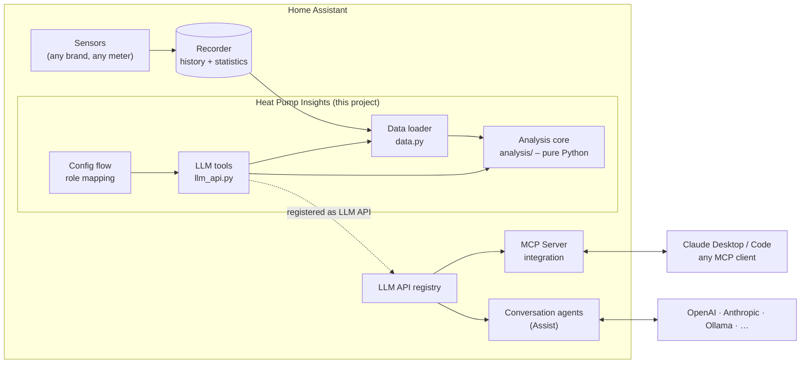
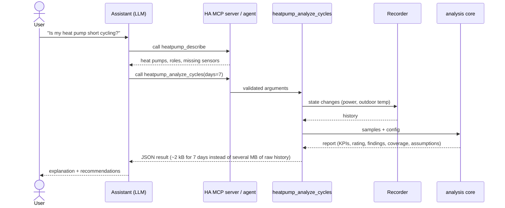

# Architecture

## Layers



| Layer | Responsibility | Depends on Home Assistant? |
|---|---|---|
| **Analysis core** (`analysis/`) | All domain logic: time series semantics, cycle detection, ratings | **No** – plain Python, unit-tested, reusable outside HA |
| **Data loader** (`data.py`) | Read recorder history, convert units (kW→W, °F→°C), map `unknown`/`unavailable` to gaps | Yes |
| **LLM tools** (`llm_api.py`) | Tool schemas, argument validation, choose heat pump, call core, attach context | Yes |
| **Config flow** | Map the user's entities to roles; tuning options | Yes |

Keeping the core free of Home Assistant imports is a deliberate rule: it makes the expertise
testable with recorded data, keeps CI fast, and allows reuse (e.g. a standalone MCP server
or a notebook) without changing a line of analysis code.

## How a question flows



## Roles instead of brands

Vendors name things differently (`sensor.vicare_supply_temperature`,
`sensor.aquarea_main_outlet_temp`, `sensor.esp_vorlauf`). The analysis never sees these names –
only **roles**:

| Role | Example sources | Unlocks |
|---|---|---|
| `power` (required) | Shelly / smart meter on the heat pump circuit, vendor power sensor, compressor frequency | cycling, runtime, electricity per day |
| `outdoor_temp` | heat pump's own outdoor sensor, weather station, weather integration | cycling vs. weather, energy signature, heating curve |
| `flow_temp` | vendor sensor, DS18B20 on the pipe | generator flow (reference) |
| `circuit_flow_temp` | heating-circuit flow after buffer/mixer | heating curve (actual) |
| `circuit_flow_target` | controller's calculated target flow | heating curve (controller curve, delivery check) |
| `curve_slope` | controller's slope setting (number entity) | reported for reference |
| `rooms` | any `climate` entities | room comfort, limiting room |
| `valves` | switch / binary sensor / actuator power per circuit | undersupplied rooms, open circuits |
| `return_temp` | vendor sensor, DS18B20 | spread |
| `heat_energy` | heat meter (M-Bus, MQTT), vendor heat counter | real COP / SPF |
| *planned:* `operating_mode`, `compressor_state`, `dhw_temp`, `curve_shift`, `electric_energy`, `backup_heater` | | mode split, change detection, throttled rooms |

Today the user picks entities in the config flow. **Device profiles** (see
[profiles/](../profiles/README.md)) will pre-fill the mapping for known integrations.

## Tool contract

Every tool result follows the same shape so the assistant can treat them uniformly:

```jsonc
{
  "heat_pump": "Heat pump",
  "analysis_version": "0.1.0",          // bump on any change that alters numbers
  "window_start": "2026-10-18T14:00+02:00",
  "window_end":   "2026-10-25T14:00+01:00",
  "coverage_share": 0.98,                // share of the window with known data
  "longest_data_gap_min": 12.0,
  "...": "tool-specific KPIs",
  "rating": "good | attention | problem | insufficient_data",
  "findings": [{"code": "short_cycling", "severity": "problem", "message": "..."}],
  "assumptions": ["..."],
  "knowledge": "https://github.com/sommer-nt/heatpump-insights/blob/main/docs/knowledge/cycling.md"
}
```

Rules:
- **Machine-readable codes** (`findings[].code`) so behaviour can be tested and translated.
- **No prose recommendations in code.** Code reports facts and patterns; the knowledge base
  and the assistant turn them into advice. This keeps the tools language-neutral and stops
  the code from pretending to know the building.
- **Compact.** Aggregate per day / per temperature bin; never return raw series.
- **Read-only annotations** (`read_only=True, destructive=False, open_world=False`) so
  MCP clients can run the tools without scary confirmation prompts.

## Data constraints in Home Assistant

See [knowledge/home-assistant-data.md](knowledge/home-assistant-data.md). In short: full
resolution history is kept for 10 days by default (`recorder: purge_keep_days`), long-term
statistics (hourly mean/min/max) forever but only for sensors with a `state_class`. Cycle
detection needs full resolution; energy signature and heating curve can run on long-term
statistics over whole seasons.
