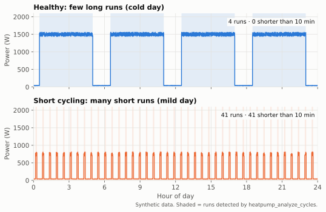

# Compressor cycling

A **cycle** is one compressor run from start to stop. Some cycling is normal – a heat pump
that can't modulate low enough *must* switch on and off on mild days. **Short cycling** means
runs so short and frequent that efficiency and component life suffer.

## Why it matters

- **Start-up losses:** after every start the refrigerant circuit needs a few minutes to reach
  stable pressures and temperatures. During that time efficiency is lower; many short runs mean
  a large share of operation is spent in this phase. *Physics / established practice.*
- **Wear:** compressor starts are the main mechanical and electrical stress on the compressor;
  oil return needs sufficiently long runs. Controllers therefore enforce minimum pause times.
  *Established practice.*
- **Comfort and noise:** frequent starts are audible and can cause temperature swings.

## The modulation gap

The building's heat demand falls roughly linearly as the outdoor temperature rises, reaching
zero at the heating limit. The heat pump's **minimum** output does not fall with it – it even
rises slightly in milder air. Above the crossing point the heat pump delivers more heat than
the house needs even at its lowest speed, so it has to stop and restart. *Physics.*

What this means for interpretation:
- Cycling **concentrated on mild days** is expected; the question is only whether runs are long
  enough. The tool's `by_outdoor_temp` table shows this pattern; the finding
  `cycling_at_mild_weather` flags it.
- Cycling **also on cold days** points to something else: oversizing, too little water flow
  or volume, a controller issue – see the table below.

## Patterns, causes, remedies

| Pattern in the data | Likely causes (most likely first) | Checks | Reversible remedies |
|---|---|---|---|
| Many short runs on **mild days**, long runs when cold | Demand below minimum output (modulation gap); oversizing | `by_outdoor_temp`; runtime per day | Increase switching hysteresis / minimum pause if the controller allows; keep underfloor circuits open; accept moderate cycling near the heating limit |
| Short runs **at all temperatures** | Too little circulating water (zones/thermostats closing), oversized unit, low pump speed, tight flow-temperature control | Are room thermostats or valves closing? Pump setting? Flow/return spread large? | Open zones fully (let the heat pump control the temperature), raise pump speed, increase hysteresis; a buffer or volume tank is the installer's option |
| Rooms overheat and runs get shorter during the day | Heating curve too high → thermostatic valves close | Room temperatures above setpoint | Lower the heating curve (see [heating curve](heating-curve.md)) |
| Regular long runs every few hours plus normal heating | **Hot water** cycles – not short cycling | Operating-mode sensor, flow temperature jumps to ~50 °C | None needed; check hot-water schedule and target temperature |
| Very short runs (< 2–3 min), repeating | Protective shutdown: high pressure, low flow, sensor fault | Error codes in the vendor app/integration | **Installer** – not a settings issue |

Make **one change at a time** and compare with the same tool after a few days of similar weather.

## How we detect cycles (`heatpump_analyze_cycles`)

Input: electrical power of the heat pump, treated as a step function (Home Assistant state
semantics – a value holds until the next one arrives).

1. **On/off threshold.** Configured by the user, or automatic: idle level = 10th percentile,
   running level = 90th percentile of the time-weighted power distribution;
   threshold = idle + max(80 W, 15 % of (running − idle)). This keeps a circulation pump running
   alone (tens of watts) below and a compressor at minimum speed (hundreds of watts) above.
   If idle and running differ by less than 150 W, no threshold is guessed. *Heuristic.*
2. **Bridge short pauses** shorter than 120 s (mode switches, short defrost dips, metering
   jitter). *Heuristic.*
3. **Ignore blips** shorter than 60 s. *Heuristic.*
4. Runs touching the window edges or a data gap are **truncated**: counted, but excluded from
   run-time statistics because their true length is unknown.

Outputs: starts per day (per day of known data), run-time median / p10 / p90, median pause,
share of short cycles, maximum starts within any 60 minutes, runtime share, electricity per
day, and per outdoor temperature bin.

### Rating thresholds

| Rule | Default | Confidence |
|---|---|---|
| Short cycle | complete run < 10 min | Heuristic (configurable 3–30 min) |
| `problem` | ≥ 30 % of complete runs are short | Heuristic |
| `attention` | ≥ 10 % short, or > 3 starts within one hour | Heuristic |
| `insufficient_data` | < 80 % coverage, or < 3 complete runs (unless only long runs) | Design rule |

These defaults will be tuned on real data in [Phase 2](../validation.md#phase-2--ground-truth-and-tuning).

### Known limitations

- **Hot water vs. heating** is not separated without an operating-mode sensor (planned role).
- **Defrost** pauses longer than 2 minutes may split one run into two.
- **Slow power reporting:** with updates only every few minutes, runs shorter than ~10 minutes
  are unreliable. Check `longest_data_gap_min`.
- Units where the **power meter includes other loads** (e.g. backup heater on the same circuit)
  can distort the levels; set the threshold manually.
EOF
echo ok