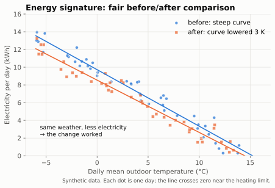

# Energy signature and fair comparisons

Raw consumption totals are useless for judging a change: last week may simply have been
warmer. The **energy signature** fixes this.



## Energy signature

Plot energy per day against the **daily mean outdoor temperature**. Below the heating limit the
points lie roughly on a straight line:

- **Slope:** for *heat* energy, the building's heat loss coefficient (kWh per day per K → ×1000/24
  = W/K). For *electricity* the line is slightly curved because COP falls as it gets colder.
- **Zero crossing:** the effective heating limit.
- **Offset at warm temperatures:** hot water and standby.

*Physics / established practice.* A change is judged by comparing **lines** (before vs. after)
over the **same temperature range**, not totals.

## Degree days

```
HDD = Σ max(0, T_base − T_mean,day)
```

Common bases: 15.5 °C (UK), 15 °C (Germany, *Heizgradtage*; VDI 3807 also uses the
*Gradtagzahl* 20/15), 65 °F ≈ 18.3 °C (USA). Consumption per degree day is a quick normalised
metric – simpler but cruder than the signature. *Established practice.*

## Similar days

To compare two specific days: same daily mean outdoor temperature (± 1 K), similar solar
radiation and wind, same weekday type (occupancy), no hot-water anomaly. *Heuristic.*

## Pitfalls

- **Solar gains** lower consumption on sunny days – a signature mixing sunny and grey days scatters.
- **Hot water** adds a temperature-independent offset; separate it with a mode sensor if possible.
- **Setpoint changes, holidays, guests, drying laundry** – the tool should report outliers, the
  assistant should ask.
- **Too few days:** we require a minimum number of days and overlapping temperature range before
  stating a difference, and report the uncertainty of the fit.
