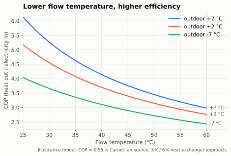

# Fundamentals

## COP, SPF, SCOP

| Term | Definition | Measured how |
|---|---|---|
| **COP** (coefficient of performance) | heat output ÷ electrical input **at one moment / operating point** | lab test point (e.g. A7/W35 = air 7 °C, water 35 °C) or live measurement |
| **SPF** / JAZ (seasonal performance factor, *Jahresarbeitszahl*) | Σ heat ÷ Σ electricity **over a period** (usually a year) | heat meter + electricity meter on the real installation |
| **SCOP** | seasonal COP **calculated** from lab points for a reference climate (EN 14825) | datasheet; not a measurement of your house |

*Physics / established practice.* Only a heat meter gives a real COP/SPF. Vendor "heat
produced" counters are often estimates; we flag them as such.

## Carnot: why temperature lift is everything

The theoretical maximum COP of a heat pump is

```
COP_carnot = T_hot / (T_hot − T_cold)        temperatures in kelvin
```

Real machines achieve a fraction of this (a quality factor of roughly 0.4–0.6 for modern
units). *Physics; quality factor = established practice.*



## Flow temperature is the biggest lever

The smaller the lift between the heat source (outdoor air, ground) and the heating water, the
higher the COP. With the model above, every kelvin of lower flow temperature improves COP by
**about 1.5–2.5 %** (more at low flow temperatures and mild weather); figures of 2–3 % per K are
commonly quoted. *Physics; magnitude = model estimate.*

Consequences for the analyses:
- A heating curve that is a few kelvin too high costs efficiency every hour of the season.
- Anything that forces a higher flow temperature – closed valves, poor hydraulic balancing,
  undersized emitters, low flow rate – costs efficiency.

## Heat output from flow rate and spread

```
Q̇ = ṁ · c_p · ΔT
Q̇ [W] ≈ 1.163 × V̇ [l/h] × ΔT [K]          (water; c_p ≈ 4.19 kJ/(kg·K))
```

Example: 1 000 l/h at 5 K spread ≈ 5.8 kW. *Physics.* With a flow meter, flow and return
temperature you can estimate heat output (and thus COP) without a dedicated heat meter –
with the accuracy of the cheapest sensor in the chain.

## Sizing, modulation and backup heat

- **Design heat load** is the building's heat loss at the design outdoor temperature
  (EN 12831 in Europe). A heat pump sized well above it will spend most of the season below
  its minimum output → [cycling](cycling.md#the-modulation-gap). *Established practice.*
- **Inverter heat pumps modulate** – they vary compressor speed. The modulation range is
  limited (the minimum output is often a third to a quarter of the maximum; check the
  datasheet – it also depends on temperatures). *Established practice; ratio = typical, varies by model.*
- **Bivalence point:** below it, a backup heater (electric element or boiler) helps. Backup
  electricity counts 1:1 (COP 1) and must be included in any efficiency figure.
