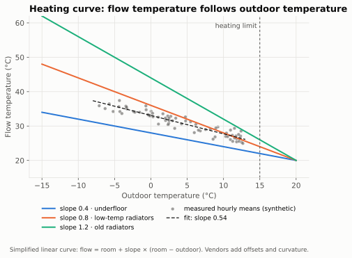

# Heating curve

The heating curve (*Heizkurve*, weather compensation) sets the target flow temperature from the
outdoor temperature: colder outside → warmer water. It is the single most important setting
for efficiency ([fundamentals](fundamentals.md#flow-temperature-is-the-biggest-lever)).

## Parameters

| Parameter | Effect | Vendor names (examples) |
|---|---|---|
| **Slope** (*Neigung*) | How much the flow temperature rises per kelvin of colder weather | slope, gradient, curve number |
| **Parallel shift** (*Niveau*) | Moves the whole curve up/down by a fixed amount | shift, offset, level, room setpoint |
| **Heating limit** (*Heizgrenze*) | Outdoor temperature above which heating stops | summer/winter switch-over, heating limit |
| Min/max flow temperature | Clamp the curve | – |

Vendors define curves differently (some by slope and shift, some by a design point such as
"35 °C flow at −10 °C"), and many curves are slightly bent rather than straight. We therefore
analyse the **actual** flow temperature against outdoor temperature, not the vendor's formula.
*Established practice.*

## Typical ranges

| Emitters | Typical design flow temperature at design outdoor temperature | Confidence |
|---|---|---|
| Underfloor heating | ~30–35 °C | Established practice |
| Low-temperature / oversized radiators | ~40–45 °C | Established practice |
| Standard radiators, older buildings | ~45–55 °C | Established practice |

Heating limits of roughly 15 °C for older and 12 °C or lower for well-insulated buildings are
common starting points. *Heuristic.*

## Tuning procedure (what the assistant should recommend)

*Established practice:*
1. Set all room thermostats/valves fully open in the rooms the heat pump controls.
2. Problem appears **in cold weather** (rooms cold/warm when it is freezing) → adjust the
   **slope**. Problem appears **in mild weather** → adjust the **shift**.
3. Change in small steps (1–2 K shift, or one slope step) and wait 1–2 days – underfloor
   heating reacts slowly.
4. Go down until the coldest room you care about is *just* comfortable; single rooms that stay
   cold are a hydraulic balancing / emitter issue, not a curve issue.

## How we analyse it (`heatpump_heating_curve`)

- **Hourly means** from Home Assistant's long-term statistics, so the window can span up to
  60 days (sensors without statistics fall back to the 10-day state history).
- If the controller exposes its **target flow temperature**, the curve is fitted on that target:
  it is the controller's own curve, undisturbed by hot water, defrost or standstill. The measured
  flow is then used to check delivery (`tracking`: mean actual − target, share of hours more than
  2 K short). Without a target, the measured heating-circuit flow is used.
- **Robust line fit (Theil–Sen):** the median of all pairwise slopes. Hot-water or defrost hours
  barely move it – unlike an ordinary least-squares fit.
- Output: slope in **K per K** (flow rise per kelvin colder), flow at +10 / 0 / −10 °C (each
  marked when extrapolated), R², residual spread, hours used, covered outdoor range, and the
  controller's slope setting for reference. Vendor slope numbers use their own scales; the
  fitted K/K slope is comparable across brands.
- Findings: `narrow_outdoor_range` (< 8 K covered – colder weather is extrapolated),
  `curve_fit_poor` (R² < 0.5), `poor_tracking` (≥ 20 % of hours undersupplied),
  `insufficient_data` (< 24 hours). *Heuristics, to be validated.*
- Combine with [room comfort](rooms.md) before recommending a change: overheated rooms mean the
  curve can go down; a single cold room is a balancing or emitter issue.
