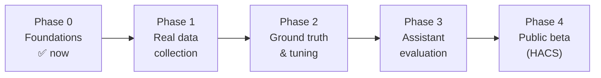

# Validation plan

How do we know an analysis is *right* – for heat pumps we have never seen, in climates we do
not live in? This document is the answer. Nothing is called "validated" until it has passed
the gates below.

## Three questions, three kinds of evidence

| Question | Evidence | Where |
|---|---|---|
| **1. Does the code compute what we intend?** | Unit tests with synthetic series whose correct answer is known by construction (edge cases, gaps, DST, noise) | `tests/` – runs in CI on every push |
| **2. Does the analysis match reality?** | Recorded real data, labelled by a human ("ground truth"), compared with the tool's output | `tests/fixtures/real/` (anonymised, with consent) |
| **3. Does the assistant give good answers?** | Blind evaluation of full assistant answers to the [use cases](use-cases.md) | `eval/` (planned) |

Question 1 is necessary but proves little: synthetic data only contains what we thought of.
Question 2 is where the real work is. Question 3 is the product.

## Phase plan with gates

### Phase 0 – Foundations ✅
- Analysis core with synthetic tests (cycle detection, gaps, DST, noise, thresholds).
- Integration skeleton, tool contract, knowledge base, this plan.
- **Gate:** CI green; one real installation produces plausible output. ✅
- *Installation #1 (air-to-water, sub-meter with ~7 samples/min plus a vendor compressor
  status as reference), one day:* the power-only detection found **every** compressor run the
  vendor status reported, with no false runs; start/stop times differ by about a minute
  (polling lag of the vendor interface). High-power runs matched the vendor's hot-water status;
  a short defrost inside a run was bridged correctly; two runs a few minutes apart were
  confirmed as two separate starts. **Lesson:** `longest_data_gap_min` also counts silence of a
  report-on-change meter, which is not missing data – rename or refine.
- Real-data results are published only as anonymised aggregates like the one above: no dates,
  times, device models, entity names or locations of contributors.

### Phase 1 – Real data collection
Target: **≥ 10 installations, ≥ 5 brands, ≥ 3 countries/climates**, covering
air-to-water and ground source, underfloor and radiators, with and without buffer tank.

- A small export script (planned: `tools/export_history.py`) pulls 10 days of the mapped
  roles from a user's Home Assistant via its REST/WebSocket API and writes a fixture file:
  timestamps relative to the start, entity IDs replaced by roles, location reduced to climate
  zone. Volunteers review the file before sharing.
- Metadata per fixture: brand/model class, nominal output, emitter type, buffer yes/no,
  power meter type and reporting interval.
- Optional cross-check: open datasets such as [heatpumpmonitor.org](https://heatpumpmonitor.org)
  (OpenEnergyMonitor) for plausibility ranges. Its data licence must be clarified before any
  data is redistributed in this repository.

**Gate:** fixtures from ≥ 10 installations in the repo, each with signed-off consent.

### Phase 2 – Ground truth and tuning
- For each fixture, a human labels compressor runs (start/end) on a plot – or uses a vendor
  compressor-state / frequency sensor where one exists as reference.
- Metrics for `heatpump_analyze_cycles`:

  | Metric | Target |
  |---|---|
  | Starts per day vs. ground truth | within ± 5 % on every fixture |
  | Run detection (event F1, ± 2 min tolerance) | ≥ 0.95 |
  | Median run time vs. ground truth | within ± 10 % |
  | Rating agrees with two human experts | ≥ 9 of 10 fixtures |

- Tune defaults (auto threshold, merge gap, blip filter) **only** on a training subset; report
  metrics on the held-out rest. Any default change bumps `analysis_version`.
- Every surprising fixture becomes a regression test.

**Gate:** all targets met on held-out fixtures.

### Phase 3 – Assistant evaluation
- A fixed question set per use case, run against ≥ 2 assistants (one cloud, one local).
- Answers scored blind by heat pump experts on: correct numbers quoted, correct
  interpretation, states limits/coverage, advice safe and reversible, no invented figures.
- Compare with a baseline: the same assistant **without** these tools, only raw history.
  The tools must win clearly – otherwise they have no reason to exist.

**Gate:** ≥ 80 % of answers rated good; zero answers with invented numbers; clear win over baseline.

### Phase 4 – Public beta
- HACS custom repository → HACS default after feedback.
- Opt-in "report a wrong result" flow: user exports the window, files an issue, it becomes a fixture.

## Rules that keep us honest

1. **Heuristics are labelled as heuristics** – in code comments, in the knowledge base and in
   tool output (`assumptions`). A threshold becomes a "recommendation" only with a source or
   with data from Phase 2 behind it.
2. **No silent defaults.** Every number that influences a rating is visible in the output or
   documented and configurable.
3. **Versioned numbers.** `analysis_version` changes whenever results for the same input change.
4. **Insufficient data beats a wrong answer.** Ratings fall back to `insufficient_data` when
   coverage or sample size is too low.
5. **Privacy first.** Fixtures contain no entity names, coordinates or absolute dates unless
   the contributor explicitly allows it.

## The first concrete steps

1. Run `heatpump_analyze_cycles` on the first real installations and compare the automatic
   threshold with the real idle / pump-only / compressor levels.
2. Write `tools/export_history.py` and the fixture format.
3. Ask for volunteers (Home Assistant community forum, German and English heat pump forums).
4. Implement the heating curve fit in parallel – it needs flow temperature data, which most
   vendor integrations provide.
